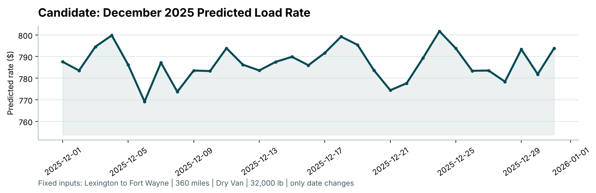

# Freight Rate Prediction

Predicts the **posted rate (USD) for a full truckload** from its lane, distance, equipment type, weight, date and market signals.

The model is a LightGBM regressor trained on `log(rate per mile)`, with a cleaning step for the data-quality problems in the raw file and a **time-based backtest** that mirrors the real task of pricing future loads. Across three out-of-time folds it averages **about 3% MAPE, against about 8% for a simple baseline**.

| | |
|---|---|
| Training data | 48,000 labelled loads, Jan 1 – Oct 31 2025 |
| Prediction target | 12,000 loads, Nov 1 – Dec 31 2025 (`data/validation.csv`) |
| Model | LightGBM, L1 loss, target = log(rate per mile) |
| Backtest MAPE | 1.9% / 4.2% / 3.0% across three 2-month folds (baseline: 9.0% / 8.0% / 8.1%) |
| Deliverables | `validation_predictions.csv`, `reports/Freight_Rate_Report.pdf`, `scorer_results/candidate_december.png` |

---

## Contents

1. [Quick start](#quick-start)
2. [Repository layout](#repository-layout)
3. [Data](#data)
4. [Data-quality issues and fixes](#data-quality-issues-and-fixes)
5. [Features](#features)
6. [Model](#model)
7. [Validation strategy](#validation-strategy)
8. [Results](#results)
9. [December prediction chart](#december-prediction-chart)
10. [Limitations and next steps](#limitations-and-next-steps)

---

## Quick start

**Requirements:** Python 3.10–3.13. pandas 2.x does not run on Python 3.14+.

```bash
git clone https://github.com/bikash9cmd/freight-rate-prediction.git
cd freight-rate-prediction

python3.13 -m venv .venv
source .venv/bin/activate          # Windows: .venv\Scripts\activate
pip install -r requirements.txt

# 1. Backtest, train the final model, write all predictions (about 1 minute)
python src/train.py

# 2. Validate the output files and draw the December chart with the provided scorer
python score.py --predictions validation_predictions.csv \
                --december-predictions data/december_chart_inputs.csv
```

`src/train.py` produces:

| File | Contents |
|---|---|
| `validation_predictions.csv` | `load_id,predicted_rate` for all 12,000 validation loads |
| `data/december_chart_inputs.csv` | `predicted_rate` filled in for the fixed December lane (31 days) |
| `reports/backtest_results.csv` | Per-fold metrics from the time-based backtest |
| `reports/feature_importance.csv` | Share of total gain per feature in the final model |
| `reports/cleaning_stats.json` | Road factor learned from the training data |

`score.py` checks both prediction files (row counts, IDs, no blanks or non-numeric values) and writes `scorer_results/candidate_december.png`.

Results are deterministic (fixed seed 42). Re-running reproduces the committed files.

---

## Repository layout

```
.
├── data/
│   ├── train_test.csv                     # labelled development data (Jan-Oct 2025)
│   ├── validation.csv                     # 12,000 loads to predict (Nov-Dec 2025)
│   ├── validation_predictions_template.csv
│   └── december_chart_inputs.csv          # fixed lane, one row per December day
├── src/
│   ├── features.py                        # cleaning, outlier flagging, feature building
│   └── train.py                           # backtest, final model, predictions
├── reports/
│   ├── Freight_Rate_Report.pdf / .docx    # written report
│   ├── backtest_results.csv
│   ├── feature_importance.csv
│   └── cleaning_stats.json
├── scorer_results/candidate_december.png  # chart produced by score.py
├── score.py                               # provided scorer
├── validation_predictions.csv             # final submission file
├── requirements.txt
└── ruff.toml                              # lint/format config
```

---

## Data

Each row is one load:

| Column | Meaning |
|---|---|
| `load_id` | Unique ID (`TR-…` train, `TE-…` validation) |
| `pickup`, `delivery` | City names (64 cities in training) |
| `pickup_lat/lon`, `delivery_lat/lon` | City coordinates |
| `distance` | Road distance in miles (70 – 3,440) |
| `equipment` | `Dry Van` (57%), `Reefer` (25%), `Flatbed` (18%) |
| `weight` | Load weight in lb |
| `date` | Pickup date |
| `market_index` | Market rate level (a daily level plus load-level noise) |
| `quote_signal` | Quote-side pricing signal |
| `posted_rate` | **Target**, in USD (median $2,031). Training data only |

**Key observations from exploration**

- **Rate scales almost linearly with distance**, but the rate *per mile* falls sharply for short hauls and then levels off.
- **Equipment matters:** Reefer (refrigerated) costs the most per mile and Dry Van the least.
- **The market moves over time.** Rates follow `market_index` and `quote_signal`, so past months are not a perfect guide to future ones.
- **12% of validation loads involve a city never seen in training.** Features need to generalise beyond city names.

---

## Data-quality issues and fixes

All cleaning lives in `src/features.py`. Every statistic used for cleaning (road factor, daily index) is **learned from the training slice only** and passed in, so no information leaks from test or validation rows.

| Issue | Rows (train) | Detection | Fix |
|---|---|---|---|
| Negative weights | 292 | `weight < 0` | Sign error, so take the absolute value |
| Missing weights | 300 | `NaN` | Left missing; LightGBM routes missing values natively |
| Impossible distances | 111 | Road distance ÷ straight-line (haversine) distance outside **1.05–1.60** | Rebuilt as straight-line × **1.18**, the median road factor of valid rows |
| Missing `market_index` | 374 | `NaN` | Filled with that day's average index |
| Corrupted labels | 707 (1.5%) | Rate per mile more than **1.6×** above or below the median for the same lane and equipment (or for the equipment and distance band when a lane has fewer than 5 loads) | Excluded from training and from backtest scoring |

The flagged labels sit at roughly 0.2–0.5× or 2–5× their lane's normal rate. That looks like entry or unit errors rather than real market moves, which would affect a whole day or lane, not a single load.

The same input fixes are applied to `validation.csv` (145 negative weights and 249 missing index values there).

---

## Features

Built in `build_features()`:

| Feature | Why |
|---|---|
| `log_distance` | Captures the falling per-mile cost of longer hauls |
| `straight_line_mi` | Distance signal that is robust to errors in the `distance` column |
| `pickup_lat/lon`, `delivery_lat/lon` | Location. Works for unseen cities, unlike city names |
| `lat_change`, `lon_change` | Direction of travel (headhaul vs backhaul markets) |
| `equipment` | Categorical: Dry Van / Reefer / Flatbed |
| `weight` | Heavier loads price higher |
| `market_index`, `daily_market_index` | Load-level and day-level market conditions |
| `quote_signal` | Market pricing signal |

City names are deliberately **not** used: one-hot or target-encoded cities would carry no information for the 12% of validation loads in new cities.

---

## Model

`LGBMRegressor` with:

- **Target `log(posted_rate / distance)`.** Dividing by distance puts short and long hauls on one scale. The log makes errors relative (percentage-like) and stabilises variance. Predictions are converted back with `exp(prediction) × distance`.
- **`objective="l1"`.** Absolute-error loss, so any corrupted labels that survive cleaning have limited pull on the model.
- **Regularised settings:** 1,500 trees, learning rate 0.03, 63 leaves, `min_child_samples=40`, 80% row and column subsampling, `reg_lambda=1.0`, seed 42.

Gradient-boosted trees suit this problem: a mix of numeric and categorical inputs, native handling of missing values, and non-linear interactions (for example distance × equipment × market) without manual feature crosses.

**Feature importance** (share of total gain, final model):

| Feature | Gain share |
|---|---|
| quote_signal | 22.0% |
| straight_line_mi | 16.8% |
| log_distance | 15.2% |
| equipment | 13.7% |
| daily_market_index | 8.4% |
| weight | 6.6% |
| market_index | 3.7% |
| coordinates and direction (6 features) | 13.5% combined |

---

## Validation strategy

`validation.csv` covers **Nov–Dec 2025, strictly after** all labelled data. A random train/test split would let the model learn from rows in the same weeks it is tested on, which overstates accuracy for a forecasting task.

The backtest therefore uses an **expanding time window** (`time_based_validation()` in `src/train.py`):

```
Fold 1:  train Jan–Apr  ─────────────▶  test May–Jun
Fold 2:  train Jan–Jun  ─────────────────────▶  test Jul–Aug
Fold 3:  train Jan–Aug  ─────────────────────────────▶  test Sep–Oct
Final:   train Jan–Oct  ──────────────────────────────────────▶  predict Nov–Dec
```

In each fold:
- The cleaning statistics and the model are fitted on the training months only.
- Metrics are computed on test rows with clean labels, since scoring against corrupted labels is meaningless. MAE on all rows is reported as well.
- The baseline is the median rate per mile for the equipment type (from the training months) × distance.

The final model is trained on all of Jan–Oct and applied to `validation.csv`.

---

## Results

From `reports/backtest_results.csv`:

| Test months | Train rows | Test rows | MAE ($) | MAPE | Median APE | MAE, all rows ($) | Baseline MAPE |
|---|---|---|---|---|---|---|---|
| May–Jun 2025 | 19,110 | 9,696 | 49.69 | **1.86%** | 1.24% | 103.22 | 8.96% |
| Jul–Aug 2025 | 28,806 | 9,671 | 79.25 | **4.15%** | 2.11% | 130.87 | 7.98% |
| Sep–Oct 2025 | 38,477 | 9,523 | 74.30 | **3.00%** | 2.79% | 129.85 | 8.08% |

The model is **2–5× more accurate than the baseline** in every fold. Jul–Aug is the hardest fold. After rising for five months, the market turned sharply: the monthly average `market_index` fell from 1.28 in June to 0.98 in August. Relationships learned during the climb carried over less well to the decline. The "all rows" MAE is higher because it includes the corrupted labels, where large errors are expected.

---

## December prediction chart

`data/december_chart_inputs.csv` fixes one lane (Lexington → Fort Wayne, 360 mi, Dry Van, 32,000 lb) for every day of December 2025. That file only supplies the lane, equipment, weight and date, so the remaining inputs are filled in by `december_inputs()`:

- **Coordinates:** from the city lookup in the training data.
- **`market_index`:** that day's average across December loads in `validation.csv`.
- **`quote_signal`:** the median across December validation loads.

Predicted rates range from **$769 to $802** (mean $787), and the daily variation follows the market index.



---

## Limitations and next steps

- **Market drift.** Trees cannot extrapolate beyond the market levels seen in training. A linear market term or a model of residuals over the index would handle new market regimes better.
- **Recent lane history.** Rolling lane-level rates (for example, the last 30 days' median rate per mile) would likely improve accuracy on frequent lanes.
- **Uncertainty.** Quantile models (P10/P90) would give pricing ranges instead of a single number.
- **Hyperparameter search.** The current settings are reasonable defaults. A time-aware search could tune them further.
- **Monitoring.** In production, track live error and input drift (market index, new cities) to decide when to retrain.
